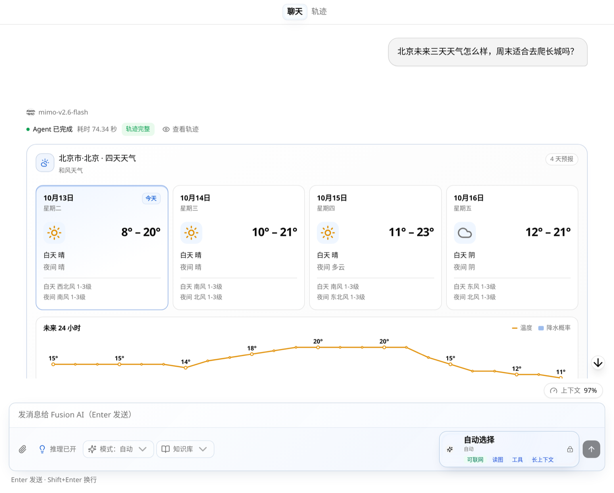
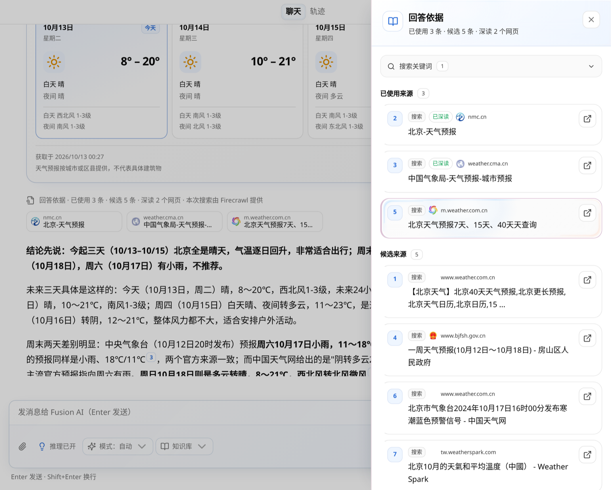
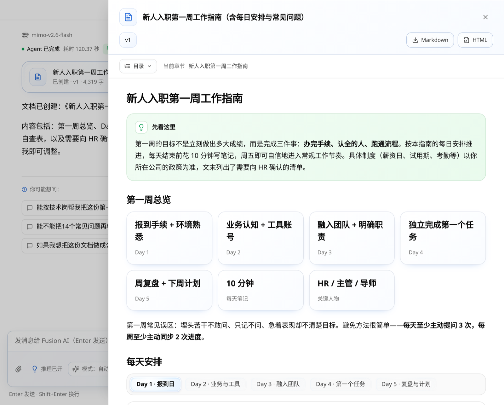
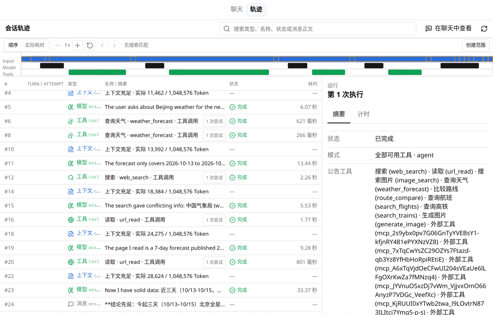
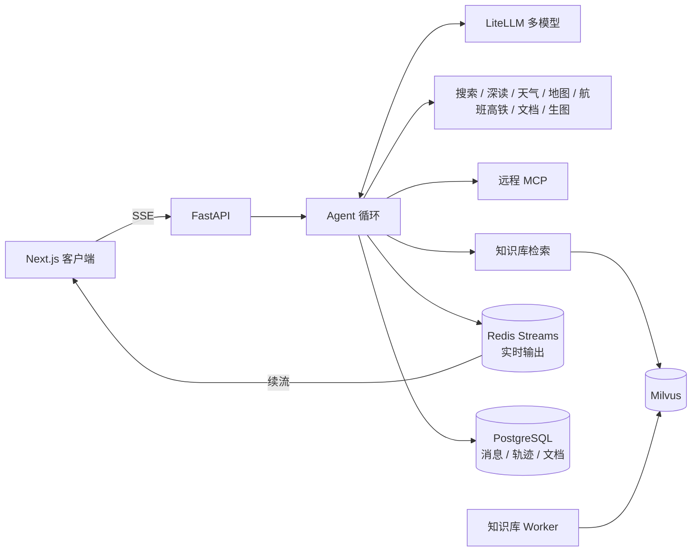

# Fusion

> 面向任务执行的 AI 工作台：一个 Agent 循环，模型自己决定查什么、读什么、做什么，每一步都有据可查。

[在线体验](https://fusion.seanfield.org/chat/new) · [后端开发](backend/README.md) · [前端开发](frontend/README.md)

[](https://github.com/HyxiaoGe/fusion/actions/workflows/pr-ci.yml)
[](https://github.com/HyxiaoGe/fusion/actions/workflows/deploy-dev.yml)



问「北京未来三天天气怎么样，周末适合去爬长城吗？」，Agent 先查和风天气拿到四天预报；发现预报不覆盖周末，再搜索并深读中央气象台和中国气象局的页面补齐，最后给出带引用的结论。整个过程没有预设流程，由模型按结果决定下一步。

> 在线环境需要登录。截图均来自 dev 环境的真实运行。

## 它能做什么

### 回答有据可查

联网回答把来源分成「已使用」「候选」和「已深读」三层，正文里的引用编号可以直接定位到对应来源。用户能看清答案用了哪些材料，以及哪些材料看过但没采用。



### 产出可交付的文档

需要成文的任务直接生成文档：流式预览、目录导航、版本记录与版本对比，可下载为 Markdown 或 HTML。后续对话可以继续修改同一份文档，生成新版本。



### 看见 Agent 怎么做的

独立的轨迹视图按时间线还原每一次模型请求、工具调用、上下文用量和耗时。刷新页面或回到历史会话，看到的是同一份服务端记录。



### 能力一览

| 类别 | 能力 |
| --- | --- |
| 信息获取 | 网页搜索、网页深读、图片搜索与回答配图 |
| 结构化工具 | 和风天气（含 24 小时趋势）、地点搜索、路线对比、航班与高铁查询 |
| 产出 | 交付物文档（创建 / 编辑 / 版本）、AI 生图 |
| 知识 | 会话文件、个人知识库（异步解析、切片、向量检索、引用定位） |
| 扩展 | 远程 MCP 服务接入、Skills（行程规划、对比选择） |
| 模型 | LiteLLM 统一接入多家模型、自动选择模型、推理开关、深度研究模式 |

## 技术亮点

### 1. 单 Agent 循环，不预判用户意图

早期版本在每个 Run 开始前先用分类模型判断任务类型，只给模型对应的工具包。实践中分类一旦出错，后面的校验、升级、兜底就要层层打补丁。现在的做法是删掉分类器：每个 Run 向模型公告全部已授权的工具，由回答模型自行选择，Run 前只处理真实边界（用户选的深度研究模式、被关闭的工具、模型是否支持工具调用）。

- 同一轮的多个工具调用并行执行；循环受超时、步数、工具调用次数三重上限约束，触达上限时强制收尾总结，不会无限搜索。
- 远程 MCP 工具同样直接公告，不做按需加载：十几个工具的定义只占几千 token，按需加载多出的一轮调用和打断的提示词缓存反而更贵。
- 提示词规则只写在对应工具的说明里，不按轮次往 system 注入；改动用真实 handler 回放对比后再上线。

### 2. 可恢复的流式输出

模型输出写入 Redis Streams，写入方通过 Lua 脚本原子校验所有权（任务 ID + 流状态），防止重连或重试时出现两个写入者。

- 离开页面不等于停止：Run 在服务端继续执行，侧栏实时显示「正在输出 / 已完成未查看」。
- 刷新或断线后从流的起点续读，接上实时输出；结束后落库，历史会话与实时会话读同一份数据。
- 支持停止与继续执行，异常和服务商内容拦截都有明确的终态，而不是让前端一直转圈。

### 3. 可审计的运行轨迹

每个 Run 共用同一个 `run_id`，事件序号加锁递增，轨迹账本记录模型请求、工具调用、上下文状态与耗时，并在结束时做完整性校验（界面上的「轨迹完整」标记）。并发压测中 18 个同时运行的 Run 全部正常收敛。

### 4. 上下文管理

多轮对话会回放历史轮次的工具调用与结果（去掉思考内容），让模型知道之前查过什么；超过阈值时先删除较旧轮次的工具记录，再截断。界面实时显示上下文用量。

### 5. 评测与发布流水线

- **回放评测**：用例描述期望行为（该调哪个工具、参数是什么、不能做什么），能用轨迹判断的不交给裁判模型；结果入库，可按用例和模型回看历史。部署后可自动跑评测门禁，同一用例出现退步时复核一次，仍失败才标红。
- **CI**：按改动范围只跑受影响的前端或后端检查，合并后自动部署 dev。
- **构建与部署**：两台 Windows runner 并行构建镜像推送到镜像仓库，dev 只拉镜像部署，API 先于 UI 上线；数据库迁移随部署自动执行。

### 规模

| 指标 | 数量 |
| --- | --- |
| 后端代码（Python，不含测试） | 约 6.7 万行 |
| 前端代码（TypeScript，不含测试） | 约 6.7 万行 |
| 测试 | 后端 265 个测试文件；前端 228 个测试文件、2500+ 用例 |
| 已合并 PR | 360+ |

## 架构



聊天正文、回答依据和轨迹视图消费同一组服务端事实，只是呈现的层次不同：正文给结论，依据给材料，轨迹给过程。

## 技术栈

| 层 | 技术 |
| --- | --- |
| 前端 | Next.js、React、TypeScript、Redux Toolkit、Dexie、Vitest |
| 后端 | Python 3.12、FastAPI、SQLAlchemy、Alembic、httpx、asyncio、pytest |
| 存储 | PostgreSQL、Redis、Milvus、对象存储 |
| 模型与工具 | LiteLLM Proxy、MCP、独立的搜索 / 网页读取 / 生图服务 |
| 交付 | GitHub Actions、Docker、Windows 自托管构建 runner |

## Monorepo

| 目录 | 作用 |
| --- | --- |
| [`backend/`](backend/) | API、Agent runtime、工具、文件、知识库、评测与治理 |
| [`frontend/`](frontend/) | Web 客户端、流式会话、回答依据、文档与轨迹界面 |
| [`ops/`](ops/) | 服务部署与运行脚本 |
| [`docs/`](docs/) | 设计、实施与验证记录 |

## 本地开发

完整运行链路依赖 PostgreSQL、Redis、Auth Service、LiteLLM，以及按需启用的搜索、Reader、MCP、对象存储和 Milvus。仓库不提供掩盖这些依赖的一键启动脚本。

```bash
git clone https://github.com/HyxiaoGe/fusion.git
cd fusion

cp backend/.env.example backend/.env
cp frontend/.env.example frontend/.env.local
```

接下来按要开发的应用进入对应指南：

- [Backend：依赖、启动、测试与结构](backend/README.md)
- [Frontend：环境变量、启动、测试与结构](frontend/README.md)

## 仓库历史

前后端代码与提交历史已合并到本仓库。原 `fusion-api` 与 `fusion-ui` 仓库已归档，仅用于历史追溯。
